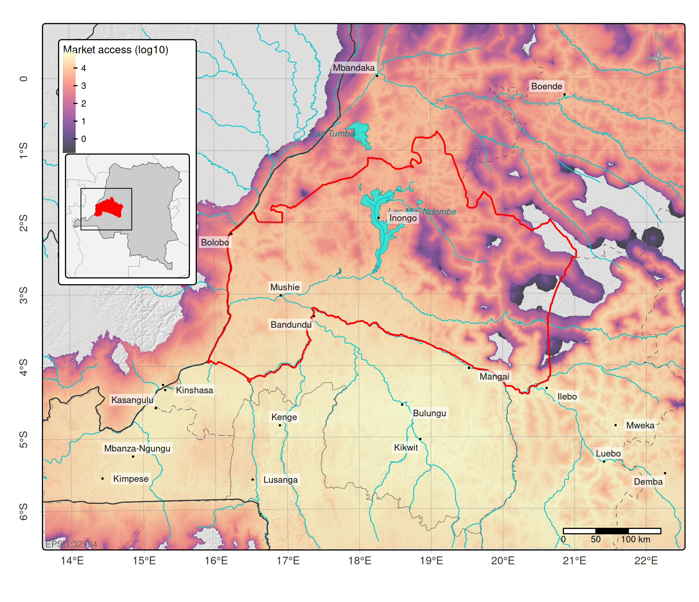

# Testing deforestation risk variables in rural demography, distance to local market, regional haulage constraints and travel time estimates, compared against forest edge effects across Mai Ndombe district, Democratic Republic of the Congo

## Abstract

The deforestation risk models of the Democratic Republic of the Congo measured access to markets as travel time to towns of 50,000 or more people. Little was known about whether those settings matched how far rural people travelled for wood, fields and trade. No study read had entered wood demand into a risk model. This study reviewed the distance and population settings of 89 published forest loss and pressure models, holding 376 variables, and 747 field measurements from 86 African studies. A second review screened 1,075 records on fuelwood, charcoal and timber supply and read 38 full texts. Of 44 models that measured access to markets, 11 stated the size of the town, 8 of them 50,000 or more people, and 9 capped travel time or distance. Only one study, of the villages supplying Bamako, fitted how wood flows to a town fell with travel time. In the field, households walked a median of 3 km to collect wood and farmed a median of 3 km from home. In the North Batéké chiefdom of Mai Ndombe, fields were normally absent beyond 8 km of a village. Of the charcoal producers surveyed in Mai Ndombe, 60% made charcoal from trees felled to open fields, and the province supplied 16.9% of Kinshasa's charcoal. A market access layer was therefore built at 1 km, treating every settlement of the High Resolution Settlement Layer as a market, whatever its size. Roads from four sources were merged, and each settlement was weighted by its population to the power 0.55 and its travel time to the power -1.25, as fitted for Bamako. The layer was built to predict the forest loss of 2016 to 2021 and to be tested against distance to the forest edge over 2021 to 2026. Risk models should therefore measure access to village markets as well as to large towns, because wood cutting and farming lay within a few kilometres of home.

*Table 1 Pressures entered in the model, with the effect on forest clearing that the literature expected of a higher value of each.*

<table>
<thead>
<tr>
<th align="left">Pressure</th>
<th align="left">Expected effect</th>
<th width="2000" align="left">Reasoning</th>
</tr>
</thead>
<tbody>
<tr><td align="left">Population density</td><td align="left">Mixed</td><td align="left">Small-scale clearing doubled with population growth across the basin from 2000 to 2014 (Tyukavina et al., 2018). In a national model for 2000 to 2005, population distribution did not predict where forest changed (Kibambe Lubamba, 2013).</td></tr>
<tr><td align="left">Travel time to Kinshasa and the river landings, by road and river</td><td align="left">Lowers</td><td align="left">Across eight Congo Basin countries, from 2000 to 2012, forest clearing fell by 0.63% with each 1% rise in travel time to the nearest market centre (Wheeler &amp; Damania, 2015).</td></tr>
<tr><td align="left">Distance to the forest edge</td><td align="left">Lowers</td><td align="left">In the Democratic Republic of the Congo, 81.53% of the forest cover changes of 2000 to 2005 lay less than 1 km from existing secondary forest (Kibambe Lubamba, 2013).</td></tr>
<tr><td align="left">Distance to new forest roads</td><td align="left">Mixed</td><td align="left">Each kilometre of first-cut road in the basin was followed by 186 ha of forest loss and degradation (Engert et al., 2025). Engert et al. (2025) wrote that industrial selective logging there could “degrade forests but lead to little outright deforestation”.</td></tr>
<tr><td align="left">Distance to settlements and camps</td><td align="left">Lowers</td><td align="left">About 80% of the deforestation of 2015 to 2020 in the six countries lay within 3 km of the nearest road or settlement (Shapiro et al., 2023).</td></tr>
<tr><td align="left">Territory’s share of Kinshasa’s charcoal</td><td align="left">Mixed</td><td align="left">In Mai Ndombe in 2021, 60% of producers made charcoal from trees felled to open fields (Dubiez et al., 2021). A review found “a mismatch” between wood energy use and forest degradation (Besisa Nguba et al., 2025).</td></tr>
<tr><td align="left">Household wealth and cooking fuel</td><td align="left">Mixed</td><td align="left">Ngouhouo-Poufoun et al. (2024) found, among 1,035 households of the Tridom landscape shared by three countries, that “a marginally higher income from cocoa production-based livelihood portfolios is associated with six to seven times higher deforestation”. In two pilot sites of Equateur province, Samndong et al. (2018) found that “shifting cultivation is driven by the poverty conditions of the study area”. Behrendt et al. (2013) judged that charcoal supply “could represent the single biggest threat to Congo Basin forests in the coming decades”.</td></tr>
</tbody>
</table>

*Table 2 Distance and population variables in 89 published risk models. Cap, a limit on travel time or distance. Decay, the form in which an effect fell with distance.*

<table>
<thead>
<tr>
<th align="left">Variable</th>
<th align="right">Studies</th>
<th align="right">Stated a town size</th>
<th align="right">Stated a cap</th>
<th align="right">Stated a decay</th>
</tr>
</thead>
<tbody>
<tr><td align="left">Distance to road</td><td align="right">54</td><td align="right">0</td><td align="right">11</td><td align="right">21</td></tr>
<tr><td align="left">Distance to river</td><td align="right">29</td><td align="right">2</td><td align="right">0</td><td align="right">10</td></tr>
<tr><td align="left">Distance to settlement</td><td align="right">26</td><td align="right">2</td><td align="right">0</td><td align="right">9</td></tr>
<tr><td align="left">Population density</td><td align="right">26</td><td align="right">1</td><td align="right">3</td><td align="right">6</td></tr>
<tr><td align="left">Distance to town</td><td align="right">24</td><td align="right">0</td><td align="right">4</td><td align="right">5</td></tr>
<tr><td align="left">Travel time</td><td align="right">18</td><td align="right">8</td><td align="right">5</td><td align="right">4</td></tr>
<tr><td align="left">Distance to forest edge</td><td align="right">14</td><td align="right">2</td><td align="right">4</td><td align="right">4</td></tr>
<tr><td align="left">Population count</td><td align="right">9</td><td align="right">0</td><td align="right">1</td><td align="right">4</td></tr>
<tr><td align="left">Distance to market</td><td align="right">5</td><td align="right">1</td><td align="right">0</td><td align="right">2</td></tr>
<tr><td align="left">Market potential</td><td align="right">5</td><td align="right">3</td><td align="right">0</td><td align="right">4</td></tr>
</tbody>
</table>

*Table 3 Distances travelled for wood, fields and trade in 86 African field studies. Values, measurements read from the studies.*

<table>
<thead>
<tr>
<th align="left">Measure</th>
<th align="right">Values</th>
<th align="right">Studies</th>
<th align="right">Range</th>
<th align="right">Median</th>
</tr>
</thead>
<tbody>
<tr><td align="left">Walk to collect wood, km</td><td align="right">16</td><td align="right">6</td><td align="right">1.0 to 5.0</td><td align="right">3.0</td></tr>
<tr><td align="left">Time per wood collection trip, h</td><td align="right">6</td><td align="right">2</td><td align="right">1.7 to 6.0</td><td align="right">3.5</td></tr>
<tr><td align="left">Home to field, km</td><td align="right">9</td><td align="right">4</td><td align="right">0.5 to 10.0</td><td align="right">3.0</td></tr>
<tr><td align="left">Daily carrying distance per adult, km</td><td align="right">6</td><td align="right">1</td><td align="right">1.0 to 7.0</td><td align="right">3.4</td></tr>
<tr><td align="left">Village to market, km</td><td align="right">6</td><td align="right">3</td><td align="right">10.0 to 400.0</td><td align="right">25.2</td></tr>
<tr><td align="left">Village to hunting ground, km</td><td align="right">12</td><td align="right">6</td><td align="right">2.0 to 60.0</td><td align="right">17.5</td></tr>
<tr><td align="left">Wood supply distance, cities of 5 million or more, km</td><td align="right">23</td><td align="right">7</td><td align="right">50.0 to 1,000.0</td><td align="right">160.0</td></tr>
<tr><td align="left">Wood supply distance, cities of 1 to 5 million, km</td><td align="right">53</td><td align="right">9</td><td align="right">4.5 to 550.0</td><td align="right">60.0</td></tr>
<tr><td align="left">Wood supply distance, towns under 1 million, km</td><td align="right">9</td><td align="right">5</td><td align="right">5.0 to 500.0</td><td align="right">40.0</td></tr>
<tr><td align="left">Rural wood use, kg per person per day</td><td align="right">8</td><td align="right">5</td><td align="right">0.4 to 2.0</td><td align="right">1.4</td></tr>
</tbody>
</table>

*Fig. 1 Market access, Mai Ndombe and surroundings, 1 km. Red line, Mai Ndombe province; dashed lines, provinces; turquoise, rivers with a mean discharge of 100 m³/s or more and lakes of 10 km² or more.*
